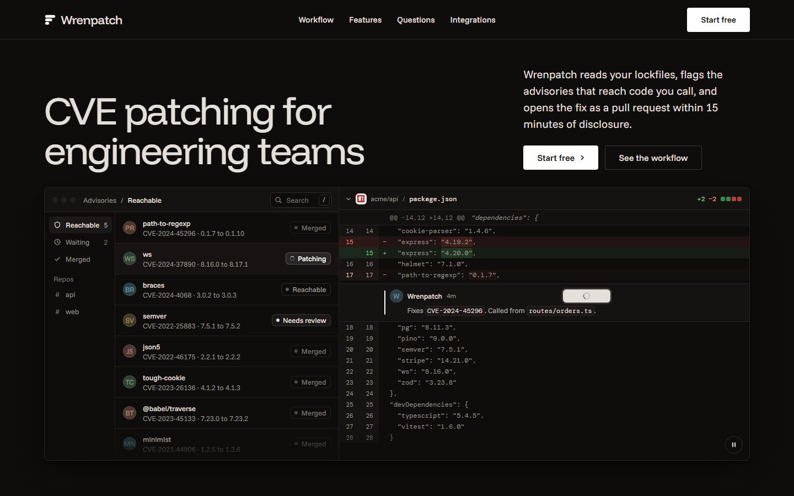

# Wrenpatch landing page

A one-page landing site for **Wrenpatch**, a fictional developer tool that tracks security advisories (CVEs) in a team's dependencies, checks whether the vulnerable code is actually called, and opens the fix as a tested pull request.

The visual style follows [duckurity.com](https://duckurity.com/): a warm near-black background, off-white text, Funnel Display headlines, mono type for code, square buttons and thin dividing lines. Every place the reference uses orange (buttons, links, focus outlines) is white here. The copy, code and product are original.



## Sections

1. **Hero:** headline, short description, "Start free" and "See the workflow" buttons, and an app window showing a list of advisories beside a `package.json` patch.
2. **Workflow:** three steps (read lockfiles, trace the call path, open a tested pull request) that hold on screen while you scroll.
3. **Features:** Slack alerts to the owning team, and per-repository merge rules.
4. **Questions:** a short FAQ.
5. **Integrations:** a diagram with GitHub, GitLab, npm, PyPI, Slack and Jira.
6. **Footer:** a closing call to action and links.

## Run it locally

The site is plain HTML, CSS and JavaScript with no build step. Serve the folder over HTTP (opening the file directly with `file://` blocks the JavaScript modules):

```bash
npx serve .
```

or

```bash
python -m http.server 8000
```

Then open http://localhost:8000 (or the address `serve` prints).

## Files

| Path | What it is |
| --- | --- |
| `index.html` | The landing page |
| `privacy.html`, `terms.html` | Short placeholder legal pages |
| `assets/` | Design system: styles, scripts, UI fragments, motion, diagrams and icons |
| `favicon.svg` | Site icon |
| `share.jpg` | Preview image for shared links |
| `names.json` | Record of the search that checked the name "Wrenpatch" was free |

## Before going live

- The "Start free" buttons open an email to `hello@wrenpatch.example`. Replace them with the real sign-up link.
- "Within 15 minutes of disclosure" in the hero is a placeholder claim; confirm or change it.
- `privacy.html` and `terms.html` are stand-ins.
- Add the canonical link in `<head>` once the domain is known.
- There is no pricing section yet.

The CVE numbers and fixed versions in the app mock-up are real, public advisories.

## Fonts and icons

Fonts load from Google Fonts: Funnel Display, Funnel Sans and DM Mono. Product logos come from SVG Logos and Simple Icons; product names and logos are trademarks of their owners.

## License

[MIT](LICENSE)
